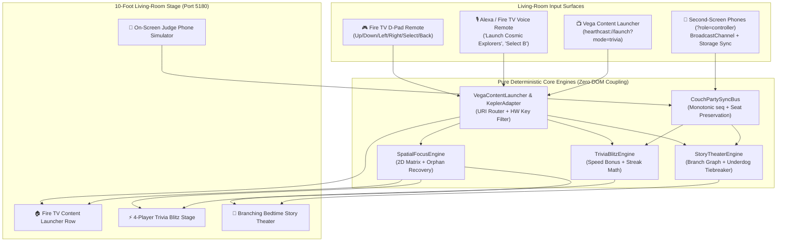

# 🏗️ System Architecture — HearthCast TV (Fire TV & Vega OS)

## 1. High-Level Architecture Diagram

---

## 2. Key Engineering Invariants

1. **Zero Orphaned Focus States (`ensureValidFocus`)**:
   - Whenever the user switches between the Fire TV Home Row, Trivia Blitz, or Bedtime Story Theater—or when a story reaches an ending screen with `0` branch choices—`ensureValidFocus` verifies that `activeNodeId` exists in the mounted node set and deterministically snaps to the screen's primary action if the prior node unmounted.
2. **Monotonic Sequence Deduplication (`applyPartyEnvelope`)**:
   - Second-screen events arrive with `(senderId, seq, msgId)`. Duplicate `msgId`s and stale sequence numbers (`seq <= lastSeqBySender[senderId]`) are rejected at the bus boundary.
   - If a player's phone sleeps and reconnects mid-round (`PLAYER_DISCONNECT` $\to$ `PLAYER_JOIN`), their original `seatIndex` and trivia scoreboard record are preserved intact.
3. **Fair Family Underdog Tiebreaker (`resolveStoryBranchSelection`)**:
   - When a couch story vote ties (e.g., `2 vs 2`), each tied choice is scored by the minimum `tiebreakWinsByPlayer` among its voters, ensuring younger siblings rotate tiebreak victories fairly.
